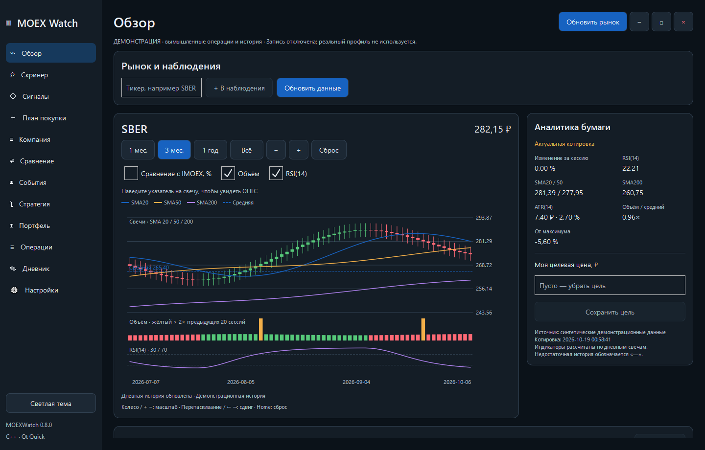
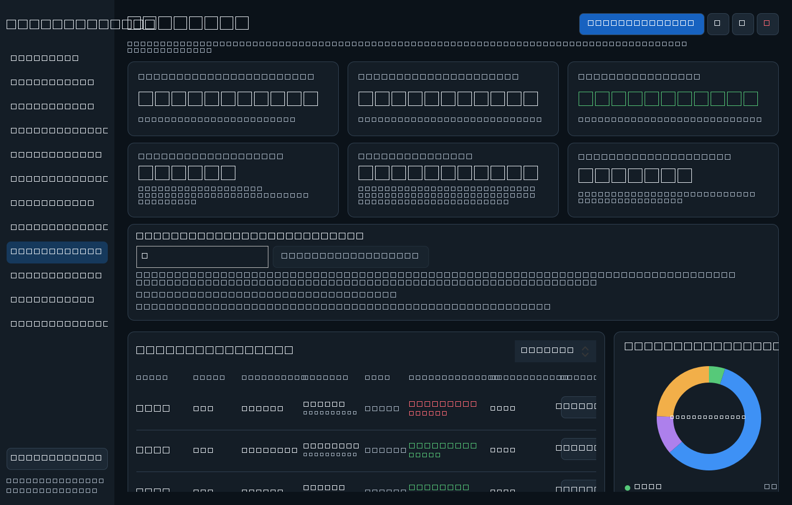
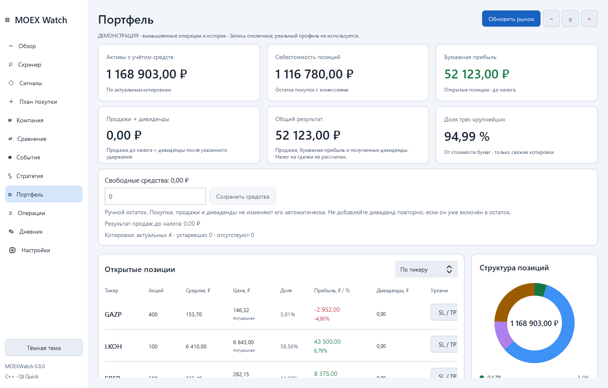
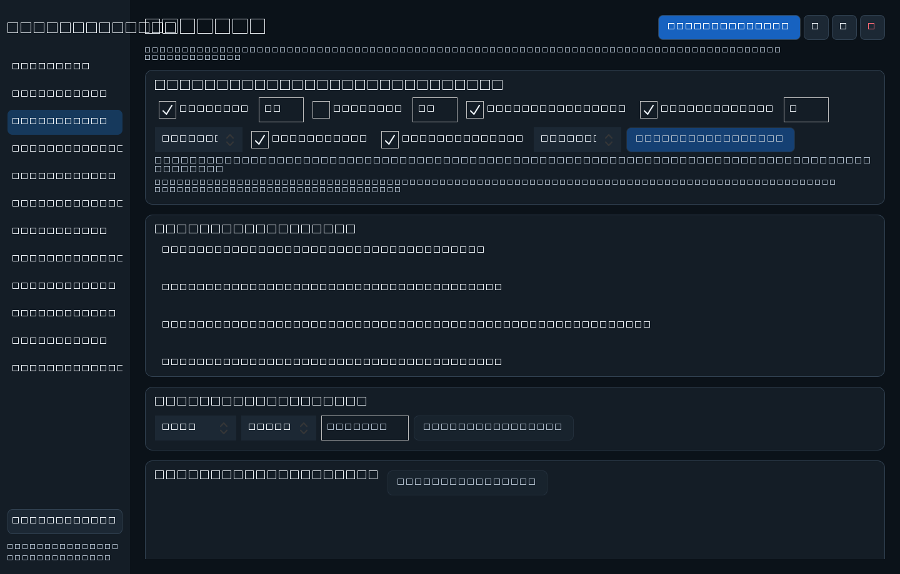
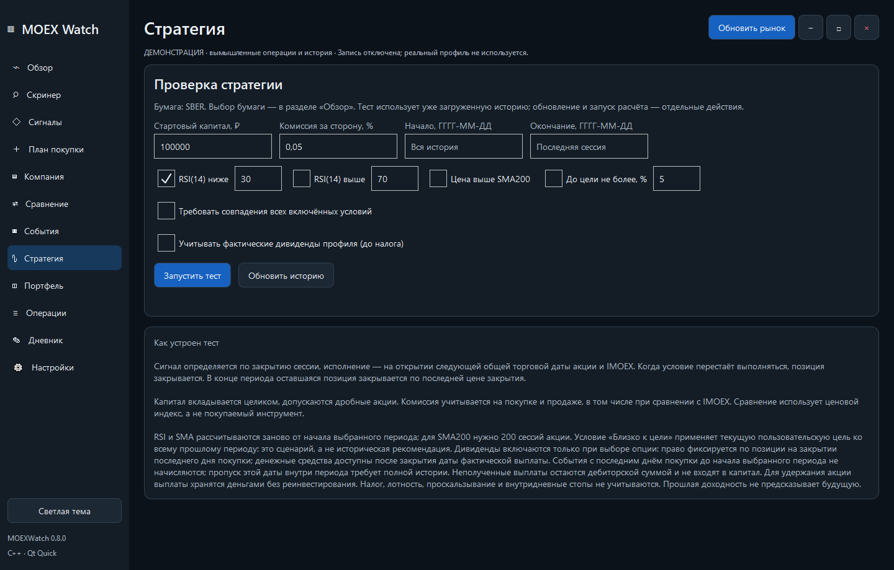

# MOEXWatch — анализ акций MOEX и портфель для Windows

**Бесплатное настольное приложение для анализа акций Московской биржи (MOEX), портфеля, дивидендов и торговых сигналов.** Написано на C++20 / Qt Quick (QML). Готовая сборка для Windows x64, исходный код и история выпусков доступны в этом репозитории.

## Скачать свежую версию

**Версия 0.8.2 · [Скачать свежий выпуск для Windows →](https://github.com/avertyu59-blip/MOEXWatch/releases/latest)**

Верхний выпуск в списке — самый новый. Скачайте его файл **MOEXWatch-<версия>-Windows-x64.zip**, распакуйте и запустите **MOEXWatch-Qt.exe**. Устанавливать Visual Studio, CMake или Build Tools для готовой сборки не требуется.

При обновлении закройте все старые копии и распакуйте новую сборку целиком в отдельную папку. В новых архивах поставляется только Qt-приложение. Классическая версия исключена; старые выпуски остаются в истории релизов. Общий профиль защищён от одновременной записи. Пользовательские данные хранятся отдельно в `%APPDATA%\MOEXWatch`; перед обновлением можно воспользоваться кнопкой «Резервная копия».

Индикатор версии вверху показывает последний стабильный GitHub Release и обновляется после публикации с учётом кэша сервиса. Тестовые Pre-release доступны отдельно в истории выпусков. Все предыдущие версии остаются в [истории релизов](https://github.com/avertyu59-blip/MOEXWatch/releases).

## Скриншоты

| Портфель и дивиденды | Светлая тема |
|---|---|
|  |  |

Сигналы и проверка стратегий

## Новое в 0.8.2

- Форма записи операции очищает старую ошибку сразу при исправлении поля и указывает конкретное неверное значение.
- Проверена запись покупки с датой `2026-10-19`, тикером `SBER`, ценой `100,00` и комиссией `5`.
- Кнопки и пункты навигации увеличены до 44 px; линии графика в светлой теме соответствуют контрасту не ниже 3:1.

[Отчёт независимого аудита](docs/AUDIT_2026_10_19.md).

## Новое в 0.8.1

- Сервисы портфеля, рынка и настроек разделены; расчёт плана покупки проверяется без Qt.
- Точечные уведомления и обновление строк по ID вместо общего сброса таблиц.
- Проверка внешних изменений и резервирование предыдущей версии файлов перед записью.
- Исправлена цель сборки workflow скриншотов; прежние изображения 0.8.0 сохранены.

[Устройство изменений и ограничения 0.8.1](docs/STABILITY_0_8_1.md).

## Новое в 0.8.0

- CSV-импорт и экспорт операций в Qt: предпросмотр, ошибки, дубликаты, сохранение ID и атомарное применение.
- Сводка: стоимость и себестоимость, ручной остаток денег, качество цен и концентрация топ-3.
- Дивиденды портфеля: право по журналу, ожидаемые выплаты отдельно от факта, фактические суммы и удержанный налог по брокерскому отчёту.
- Итог с полученными дивидендами и распределение дохода по ID позиции. Бумажная прибыль и ручной остаток не увеличиваются автоматически.
- Опциональный сценарий бэктеста с подтверждёнными поступлениями профиля. Это неполная история выплат, а IMOEX остаётся ценовым индексом.

Подробные форматы, проверки и ограничения — [портфель 0.8](docs/PORTFOLIO_0_8.md).

## Возможности приложения

| Вкладка | Возможности |
|---|---|
| Обзор | Интерактивные свечи, SMA, RSI, ATR, объём, IMOEX, уровни текущей позиции |
| Скринер | Отбор наблюдаемых бумаг по RSI, SMA200, цели, объёму и ATR; причины и числовая сортировка |
| Сигналы | Технические/ценовые условия, автообновление, история переходов и уведомления Windows |
| План покупки | Целые лоты, бюджет с комиссией, лимит убытка, сценарии стопа/цели и прибыль/риск |
| Компания и сравнение | Финансовые показатели с источником/периодом, FCF, долг, рентабельность и мультипликаторы; до четырёх компаний |
| События | Автоматическая загрузка дивидендов со статусами и источниками; собственный календарь отчётностей/собраний |
| Стратегия | Историческая проверка условий с комиссией, просадкой и сравнением с ценовым IMOEX |
| Портфель и операции | Открытые позиции, покупки/продажи, прибыль, доли, уровни и резервирование |
| Дневник | Сохранение расчётной идеи, причин входа/выхода и последующего разбора с постоянными ID |

**Границы автоматизации:** фундаментальные цифры вводятся пользователем из отчёта или импортируются через JSON с проверкой и предпросмотром. Приложение проверяет формат и рассчитывает показатели, но не подтверждает подлинность отчёта и не загружает отчётность автоматически. Даты отчётностей/собраний пользователь добавляет по источнику; дивиденды загружаются из открытых источников. Скринер работает по списку наблюдения. Фактически подтверждённые дивиденды показаны отдельно и включены в явно подписанный итог. Налог по сделкам автоматически не рассчитывается; налог по дивидендам вводится фактический. Бэктест учитывает выбранные подтверждённые выплаты только по явной опции. Бэктест допускает дробное количество, не моделирует проскальзывание и лоты; полные предположения показаны на странице теста.

Новая тема, размеры/положение окна, активная страница и выбранная бумага сохраняются. `Ctrl+R` обновляет рынок; `Ctrl+1/2/3` открывают обзор, скринер и сигналы. Уведомления проверяются, пока приложение открыто; при недоступном системном трее сообщение остаётся в окне и истории.

## Цель проекта

**MOEXWatch — персональное рабочее место частного инвестора на российском фондовом рынке.** Цель проекта — объединить наблюдение за акциями MOEX, графики, журнал операций, портфель и проверку инвестиционных правил в одном понятном приложении для Windows 10.

Приложение помогает пройти путь от интереса к бумаге до оценки результата: выбрать акции для наблюдения, изучить их движение и риски, задать условия уведомления, записать свои покупки и продажи, увидеть состояние открытых позиций и проверить, как выбранное правило вело себя на прошлых данных.

Проект рассчитан на частного инвестора, который хочет вести собственный учёт и понимать, почему бумага привлекла внимание. Для каждого сигнала важно показывать причину, для оценки портфеля — доступность котировок, для дивидендного события — источник и статус.

## Какие задачи решает приложение

### Наблюдение за рынком

Список наблюдения собирает интересующие бумаги и пользовательские цели. Фильтры и сортировка помогают выделить акции по техническим условиям, а ценовые правила и история сигналов позволяют отслеживать изменения без постоянного просмотра каждой строки.

### Анализ графика и рыночного контекста

Дневные свечи и SMA показывают движение цены и тренд; RSI помогает изучать зоны перекупленности и перепроданности. ATR описывает обычный размах движения, объёмы помогают заметить повышенную активность, а сравнение с IMOEX показывает результат бумаги относительно рынка за общий период. Индикаторы служат условиями наблюдения; их значения сами по себе не подтверждают выгодность покупки.

### Учёт собственных операций

Журнал покупок и продаж формирует открытые позиции, среднюю себестоимость с комиссиями, зафиксированную и бумажную прибыль. Доли показывают распределение стоимости между учтёнными акциями. Уровни позиции связывают среднюю цену, стоп-лосс и тейк-профит с графиком; эти отметки не выставляют заявки у брокера.

CSV-импорт с предварительным просмотром облегчает перенос операций. Проверки ошибок и возможных дубликатов, локальное хранение и резервные копии помогают сохранять журнал.

### Дивиденды и события

Отдельная аналитика собирает доступные дивидендные события: сумму на акцию, доходность к цене, даты и статус. Источник и время проверки помогают отличать прогноз от подтверждённой информации. Возможности расчёта последнего дня покупки зависят от поддерживаемого торгового календаря.

### Проверка правил на истории

Бэктест позволяет изучить выбранные условия на прошлых дневных данных с комиссией и сравнить результат с удержанием IMOEX. Сигнал оценивается после закрытия сессии, исполнение моделируется на следующем открытии. Проверка помогает обнаружить слабые стороны правила; исторический результат не гарантирует будущую доходность.

## Принципы разработки

- **Проверяемые расчёты:** комиссии, порядок операций и ограничения методики должны быть описаны и покрыты подходящими тестами.
- **Понятное качество данных:** отсутствующие или устаревшие значения обозначаются явно; успешный запрос сам по себе не означает свежую котировку.
- **Сохранность журнала:** проверка входных файлов, атомарная запись и резервные копии перед изменениями, где они необходимы.
- **Объяснимые сигналы:** сохранять условие срабатывания, фактическую цену и время данных.
- **Доступный запуск:** готовые Windows-сборки в Releases, сохранение предыдущих версий и исходников.
- **Постепенное развитие:** сначала надёжная основа и проверка, затем новые функции.

## Направление развития

Приоритеты CSV, сводки и учёта дивидендных поступлений реализованы в 0.8. Следующие шаги — расширение торгового календаря за пределы 2026 года, источников выплат и импорта брокерских отчётов.

Дальнейшие направления — развитие сводки портфеля, улучшение источников и торгового календаря, расширение импорта брокерских отчётов и проработка годового налогового учёта. Это план развития, а не описание уже готовых функций; порядок уточняется перед реализацией.

Конечный ориентир — приложение, в котором можно ответить: **«Что я наблюдаю, почему возник сигнал, что у меня куплено, каков результат и на каких данных он рассчитан?»**

## Возможности опубликованных сборок

- Свечные графики, RSI, SMA, ATR, объёмы и нормированное сравнение с IMOEX.
- Портфель: покупки и продажи, открытые позиции, средняя цена, прибыль и доли бумаг.
- Уровни средней цены, стоп-лосса и тейк-профита на графике.
- Ввод операций и импорт/экспорт фундаментальных данных JSON. CSV-импорт операций доступен в Qt с предпросмотром.
- Дивидендная аналитика и события с источниками и статусами.
- Технические и ценовые условия, уведомления Windows, история срабатываний.
- Сортировка таблиц, локальный кэш дневных свечей и резервные копии.
- Проверка правил на истории с комиссией и сравнением с IMOEX.

Данные могут поступать с задержкой. Уведомления проверяются, пока приложение открыто. Ожидаемые дивиденды не входят в доход. Бэктест не располагает полным историческим календарём выплат; полноценный налоговый и FIFO-учёт не реализован. Приложение не отправляет поручения брокеру.

## Исходники и документация

**Для исходников конкретной версии** скачайте `MOEXWatch-<версия>-source.zip` из соответствующего релиза или откройте его тег.

- [Техническая история версий и устройства приложения](docs/DEVELOPMENT_HISTORY.md).
- [Актуальный исходный код](https://github.com/avertyu59-blip/MOEXWatch/tree/main).
- [Все версии и файлы для скачивания](https://github.com/avertyu59-blip/MOEXWatch/releases).
- [Страница проекта: публикация и обновление скриншотов](docs/PUBLIC_PRESENTATION.md).

Актуальный код проекта находится в ветке `main`. Исходники конкретных выпусков доступны по тегам и в архивах исходного кода соответствующих релизов.

## Проверка сборок

Перед публикацией готового EXE выполняются сборка MSVC x64 и CTest. Результаты доступны в [GitHub Actions](https://github.com/avertyu59-blip/MOEXWatch/actions). Полный визуальный проход на Windows 10 не заменяется автоматическими тестами.

